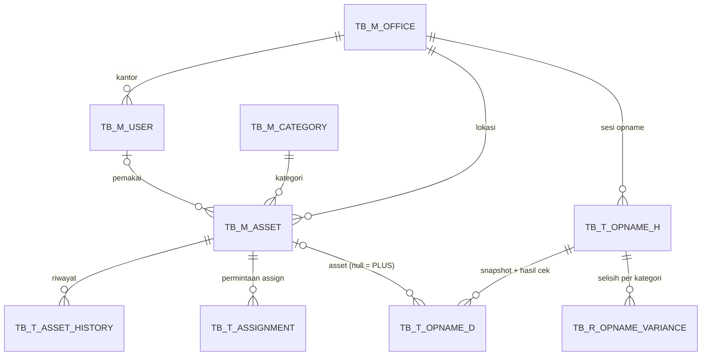

# AMS Database (SQL Server 2019/2022)

Schema adalah **database-first**: script di folder ini adalah sumber kebenaran.
EF Core di backend hanya memetakan tabel yang sudah ada, tanpa EF Migrations.

## Struktur

| Folder | Isi | Environment |
| --- | --- | --- |
| `migrations/V###__*.sql` | DDL: tabel, index, trigger, stored procedure, view | Semua (termasuk PRD) |
| `seed/S###__*.sql` | Data contoh (3 kantor, 15 user, 33 asset, 10 sesi opname) | DEV / SIT / UAT saja |
| `tests/T###__*.sql` | Test business rule di level DB + konsistensi seed | DEV / CI |
| `scripts/` | `apply.sh`, `apply.ps1`, `drop-database.sql` (dev) | – |

Setiap script mencatat dirinya di `TB_S_SCHEMA_VERSION` dan otomatis di-skip bila sudah pernah diterapkan.
Migration dijalankan dalam satu transaksi: bila gagal di tengah, seluruh isi file di-rollback.
**Jangan ubah migration yang sudah naik ke SIT/UAT/PRD**; buat file `V###` baru.

## Menjalankan (dev lokal)

```bash
cp db/.env.example db/.env
```

```bash
docker compose --env-file db/.env -f db/docker-compose.yml up -d
```

```bash
AMS_DB_PASSWORD='<password di db/.env>' SQLCMD="docker exec -i ams-sql /opt/mssql-tools18/bin/sqlcmd" db/scripts/apply.sh --seed --test
```

Windows / server on-prem:

```powershell
.\db\scripts\apply.ps1 -Server "DBSRV01" -Database AMS_DB -UseWindowsAuth
```

## Data model



| Tabel | Jenis | Catatan |
| --- | --- | --- |
| `TB_M_OFFICE`, `TB_M_CATEGORY`, `TB_M_USER`, `TB_M_ASSET` | Master (FSD §5) | Kode kantor & kategori 3 huruf kapital |
| `TB_M_ASSET_SEQ` | Master | Sequence nomor asset per kantor-kategori-tahun (BR-01) |
| `TB_T_ASSET_HISTORY` | Transaksi (FSD §5) | Append-only; `OPNAME_ID` terisi bila berasal dari approve opname |
| `TB_T_ASSIGNMENT` | Transaksi | Assign/mutasi ke user menunggu konfirmasi terima (PENDING → CONFIRMED/REJECTED) |
| `TB_T_OPNAME_H`, `TB_T_OPNAME_D` | Transaksi (FSD §5) | PK detail surrogate `OPNAME_D_ID` karena temuan PLUS tidak punya `ASSET_NO` |
| `TB_T_EMAIL_OUTBOX`, `TB_T_AUDIT_LOG` | Pendukung | Outbox notifikasi (SA §5), audit trail user/IP (SA §6) |
| `TB_R_DASHBOARD_SUMMARY`, `TB_R_OPNAME_VARIANCE` | Read model | Di-refresh lewat `USP_REFRESH_*` saat transaksi/approve |

### Kode status

| Kolom | Nilai |
| --- | --- |
| `TB_M_ASSET.STATUS` | `AVAILABLE`, `IN_USE`, `UNDER_REPAIR`, `MISSING`, `DISPOSED` |
| `TB_M_ASSET.CONDITION` | `BAIK`, `RUSAK_RINGAN`, `RUSAK_BERAT` |
| `TB_M_USER.ROLE_CD` | `ADMIN_GA`, `PIC`, `USER`, `EXEC`, `AUDITOR` (V005) |
| `TB_T_ASSET_HISTORY.ACTION` | `REGISTER`, `ASSIGN`, `TRANSFER`, `RETURN`, `STATUS_CHANGE` |
| `TB_T_ASSIGNMENT.STATUS` | `PENDING`, `CONFIRMED`, `REJECTED`, `CANCELLED` |
| `TB_T_OPNAME_H.STATUS` | `OPEN`, `SUBMITTED`, `APPROVED` |
| `TB_T_OPNAME_D.RESULT` | `SESUAI`, `BEDA_LOKASI`, `RUSAK`, `TIDAK_DITEMUKAN`, `PLUS` (NULL = belum dicek) |

## Business rule yang dijaga database

Validasi utama tetap di service API (pesan ramah user, unit test per BR). Guard di DB adalah jaring pengaman.

| BR | Mekanisme DB | Error |
| --- | --- | --- |
| BR-01 nomor unik, immutable, reset per kantor-kategori-tahun | PK, `CK_TB_M_ASSET_NO_FORMAT`, `TR_TB_M_ASSET_GUARD`, `USP_ASSET_NEXT_NO` | 50001, 50012 |
| BR-02 satu user per asset; Missing/Disposed tidak dipegang user | `CK_TB_M_ASSET_STATUS_USER`, `UX_TB_T_ASSIGNMENT_PENDING` | 547, 2601 |
| BR-04 freeze mutasi selama opname | `TR_TB_M_ASSET_GUARD` (kantor asal & tujuan), `UX_TB_T_OPNAME_H_ACTIVE` | 50004, 2601 |
| BR-05 rumus selisih | `CK_TB_T_OPNAME_H_QTY`, `USP_OPNAME_RECALC` | 547 |
| SoD hasil cek terkunci setelah submit; approver ≠ submitter | `TR_TB_T_OPNAME_D_LOCK`, `CK_TB_T_OPNAME_H_SOD` | 50011, 547 |
| Audit riwayat tidak bisa diubah | `TR_TB_T_ASSET_HISTORY_APPEND_ONLY` | 50010 |

BR-03, BR-06, BR-07 dan BR-08 dijalankan oleh service API (lihat `seed/S003__opname.sql` untuk urutan approve yang benar:
header `APPROVED` dulu, baru update asset, agar freeze BR-04 terlepas).

## Seed data (S001–S003)

Kondisi akhir sesuai contoh response `GET /dashboard/summary` di SA §4.

| Kantor | Asset | In Use | Available | Under Repair | Missing | Opname 2026-09 |
| --- | --- | --- | --- | --- | --- | --- |
| JKT | 17 | 13 | 3 | 0 | 1 | Sistem 17, Fisik 16, Minus 1 (merah) |
| JKS | 9 | 7 | 1 | 0 | 1 | Sistem 9, Fisik 8, Minus 1, Plus 1 (merah) |
| JKU | 7 | 5 | 1 | 1 | 0 | Sistem 7, Fisik 7, Minus 0 |
| **Total** | **33** | **25** | **5** | **1** | **2** | |

- Tren FR-12: sesi 2026-03 dan 2026-06 di ketiga kantor (semua sesuai).
- **JKU punya sesi 2026-10 berstatus OPEN** (4 dari 7 asset sudah dicek), jadi mutasi asset JKU sedang di-freeze (BR-04).
- `AST-JKT-LPT-2026-0003` punya assignment PENDING ke EMP009 (menunggu konfirmasi user).
- EMP010 (resign) masih memegang `AST-JKT-LPT-2024-0003` → muncul di `VW_ASSET_TO_RECALL`.

| User | Nama | Role | Kantor |
| --- | --- | --- | --- |
| EMP001 | Rina Wulandari | ADMIN_GA | JKT |
| EMP002 / EMP003 / EMP004 | Budi / Sari / Agus | PIC | JKT / JKS / JKU |
| EMP005 | Hendra Wijaya | EXEC | JKT |
| EMP016 | Ratna Kusuma | AUDITOR (V005/S004) | JKT |
| EMP006–EMP015 | karyawan | USER | JKT, JKS, JKU |

Data siap untuk UAT: TC-01 (registrasi JKT-LPT → nomor 0004), TC-02 (assign `AST-JKT-MON-2025-0004`),
TC-03 (assign `AST-JKT-PRJ-2025-0001` yang Missing), TC-05 (mutasi JKT → JKS), TC-06 (sesi baru JKT 2026-10),
TC-09 (login EMP006, buka asset milik EMP007).
