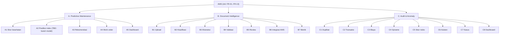
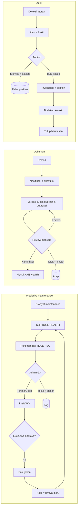
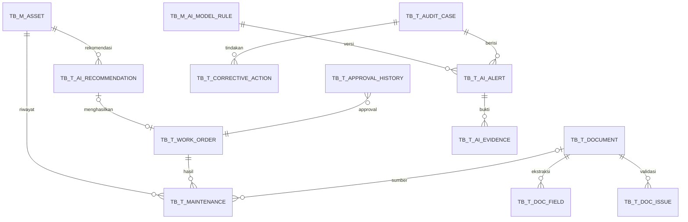

# Spesifikasi AI-Powered Asset Management System (AMS) – Draft v0.1

Oct 29, 2026 · Status: **draft untuk review stakeholder** · Lingkup data: **DKI Jakarta** (JKT Jakarta Pusat, JKS Jakarta Selatan, JKU Jakarta Utara)

Dokumen ini memperluas FSD AMS (`docs/FSD-AMS.md`) dengan tiga modul AI. Yang **sudah dibangun** adalah *simulasi sederhana* di aplikasi demo
(`frontend/`, mode demo GitHub Pages): semua "AI" berupa aturan & statistik sederhana yang transparan, **tanpa** model ML terlatih, OCR, atau LLM.
Skema DB dan API AI di bawah adalah **usulan**, belum ada di `db/migrations` (kecuali role AUDITOR, V005). Semua ambang angka = **asumsi** yang wajib divalidasi.

---

## 1. Ringkasan eksekutif & nilai bisnis

| Tujuan bisnis | Modul | Cara di simulasi v0.1 | Ukuran keberhasilan (TBD baseline) |
| --- | --- | --- | --- |
| Kurangi kerusakan tak terduga & downtime | A Predictive Maintenance | Skor kesehatan berbasis aturan + rekomendasi + work order berapproval | Downtime/asset/tahun, % PM tepat waktu |
| Otomasi entri dokumen | B Document Intelligence | Ekstraksi (template simulasi) + validasi + review manusia | Waktu proses/dokumen, tingkat koreksi manual |
| Akurasi data & cegah duplikat | B + C | Cek serial ternormalisasi, duplikat invoice & hash file | Jumlah duplikat lolos ke master |
| Deteksi transaksi/selisih tak wajar | C Audit & Anomaly | 7 aturan berversi + skor risiko | Rasio false positive, temuan terkonfirmasi |
| Kesiapan audit & investigasi | C | Kasus, tindakan korektif, asisten investigasi, log aktivitas AI | Rata-rata hari penyelesaian kasus |
| Pengawasan manusia | Semua | Tidak ada keputusan konsekuensial otomatis | 100% keputusan tercatat dengan pelaku & alasan |

## 2. Dekomposisi fungsi

## 3. Functional requirement & user story

| ID | Requirement | Status v0.1 | User story |
| --- | --- | --- | --- |
| AI-FR-A1 | Skor kesehatan 0–100 + kelas (Sehat/Pantau/Berisiko/Kritis) + faktor, hanya bila ada riwayat | ✅ simulasi | Sebagai Admin GA, saya ingin tahu asset mana yang kondisinya memburuk beserta alasannya |
| AI-FR-A2 | Probabilitas gagal 7/30/90 hari dengan confidence & versi model | ⛔ sengaja tidak ditampilkan (belum ada model tervalidasi) | – |
| AI-FR-A3 | Rekomendasi (inspeksi/PM/diagnosa/penggantian) + alasan + urgensi; terima/ubah/tolak beralasan | ✅ | Sebagai Admin GA, saya memutuskan rekomendasi dan alasan saya tercatat |
| AI-FR-A4 | Draft work order dari rekomendasi; approval manajemen; status & hasil aktual | ✅ | Sebagai Executive, saya menyetujui WO sebelum dijadwalkan |
| AI-FR-A5 | Dashboard: dimonitor, kritis, berisiko, PM terlambat, biaya & downtime 12 bln | ✅ | |
| AI-FR-B1 | Upload PDF/JPG/PNG ≤ 10 MB, hash, status proses | ✅ (isi dari template) | Sebagai PIC, saya mengunggah invoice dari HP |
| AI-FR-B2 | Klasifikasi + confidence; < 75% wajib pilih manual | ✅ | |
| AI-FR-B3 | Ekstraksi field invoice / garansi / laporan perbaikan + sumber + confidence | ✅ (template) · manual, akuisisi/disposal = TBD | |
| AI-FR-B4 | Validasi vs master asset, PO, duplikat; tidak menimpa data produksi | ✅ | |
| AI-FR-B5 | Layar review: pratinjau, field, sumber, confidence, status (OK / Tidak ditemukan / Tidak terbaca / Bertentangan / Perlu verifikasi), koreksi, approve/tolak | ✅ | Sebagai Admin GA, saya mengonfirmasi data sebelum masuk master |
| AI-FR-B6 | Setelah konfirmasi: invoice → asset baru (BR-01), garansi → tautan asset, laporan → riwayat maintenance; audit trail | ✅ | |
| AI-FR-B7 | Metrik volume, confidence, koreksi, duplikat, flag keamanan | ✅ sebagian (akurasi per field butuh ground truth = TBD) | |
| AI-FR-C1 | Duplikat asset (serial ternormalisasi) – tanpa merge otomatis | ✅ DUP-01 | Sebagai Auditor, saya melihat field yang membuat dua record dianggap mirip |
| AI-FR-C2 | Transaksi tak biasa; bedakan pelanggaran kebijakan vs anomali | ✅ TRX-01 (sering pindah), TRX-02 (dipegang karyawan non-aktif) | |
| AI-FR-C3 | Anomali biaya vs median pembanding sejenis (min. 3 pembanding) | ✅ MNT-01 | |
| AI-FR-C4 | Selisih opname: hilang terkonfirmasi vs proses belum selesai, temuan plus | ✅ OPN-01..03 | |
| AI-FR-C5 | Skor risiko + severity + bukti + versi aturan; bukan probabilitas | ✅ | |
| AI-FR-C6 | Asisten investigasi: fakta bersitasi vs hipotesis | ✅ template (bukan LLM) | |
| AI-FR-C7 | Kasus: investigator, temuan, klarifikasi, tindakan korektif, eskalasi, false positive beralasan | ✅ | |
| AI-FR-C8 | Dashboard audit | ✅ sebagian (per departemen & recurring findings = TBD) | |
| AI-FR-C9 | Log pencarian/akses bukti/keputusan | ✅ log aktivitas AI | |

## 4. Alur proses

## 5. Spesifikasi layar (ringkas)

| Layar | Tujuan | Role | Komponen & aksi | State & otorisasi |
| --- | --- | --- | --- | --- |
| Kesehatan Asset (A1/A5) | Prioritas asset bermasalah | Admin GA, PIC (kantornya), Executive | KPI, grafik biaya/downtime, tabel skor + filter kelas, tombol hitung ulang (Admin) | Kosong: "Data belum cukup"; error dengan retry |
| Detail Kesehatan | Penjelasan skor | sama | Faktor & bukti, catatan prediksi, riwayat maintenance, rekomendasi | Label AI vs data tercatat |
| Rekomendasi | Keputusan manusia | Admin GA putuskan; lainnya lihat | Kartu rekomendasi + bukti; Terima / Ubah / Tolak (alasan wajib) | |
| Work Order | Approval & penyelesaian | Executive approve/tolak; Admin GA catat selesai | Tabel WO; dialog approval / penyelesaian | SoD: pembuat ≠ penyetuju |
| Dokumen – antrian (B1/B7) | Pantau proses | Admin GA, PIC (unggahannya / kantornya), Executive, Auditor (lihat) | Metrik, filter status, tabel, Unggah | Validasi tipe/ukuran di klien & server |
| Dokumen – review (B5) | Konfirmasi data | Admin GA approve; PIC koreksi | Pratinjau teks, field + status + sumber + confidence, koreksi, Konfirmasi / Tolak | Tombol konfirmasi nonaktif sampai semua OK, tanpa duplikat & flag keamanan |
| Audit – alert (C8) | Triage temuan | Auditor (kelola), Executive (lihat) | KPI, filter kategori, tabel skor/severity/sifat, Jalankan deteksi | Admin GA tidak punya akses (subjek audit) |
| Alert detail (C5/C6) | Bukti & investigasi | sama | Bukti, record sumber, saran, asisten, Buat kasus / Dismiss | Akses bukti tercatat |
| Kasus (C7) | Investigasi & remediasi | Auditor | Status, catatan/klarifikasi, tindakan korektif + PJ + tenggat | Tutup hanya bila tindakan selesai |
| Aktivitas AI | Jejak AI | Admin GA, Executive, Auditor | Tabel log + versi aturan | |
| Detail asset (SCR-04) | Konteks | semua kecuali User | Ringkasan skor & dokumen terkait dalam kotak "AI · simulasi" | |

Desain: token warna prototipe; semua keluaran AI berada dalam kotak ungu bertanda **AI · simulasi** agar beda dari record terverifikasi.

## 6. Data model (usulan)

| Tabel | Kolom utama (tipe, wajib*) | Validasi / catatan | Sumber kebenaran | Retensi (TBD) |
| --- | --- | --- | --- | --- |
| TB_M_ASSET_LOCATION | LOCATION_ID* int PK, OFFICE_CD* FK, FLOOR, ROOM | Lokasi detail di dalam kantor | AMS | Selama aktif |
| TB_T_MAINTENANCE | MAINT_ID* bigint PK, ASSET_NO* FK, MAINT_TYPE* (PREVENTIVE/CORRECTIVE/INSPECTION), MAINT_DT*, ISSUE*, FAILURE_CD, ROOT_CAUSE, ACTION*, PARTS_COST* dec(18,2) ≥0, LABOR_COST* ≥0, DOWNTIME_HOURS ≥0, VENDOR, INSPECTION_RESULT, SOURCE_DOC_ID FK, WORK_ORDER_ID FK | MAINT_DT ≤ hari ini; append-only | AMS / dokumen terkonfirmasi | 5 th (SA §7) |
| TB_T_WORK_ORDER | WO_ID* PK, WO_NO* UQ, ASSET_NO* FK, REC_ID FK, ACTION*, PRIORITY*, TARGET_DT*, ASSIGNEE*, STATUS* (DRAFT/APPROVED/REJECTED/COMPLETED/CANCELLED), CREATED_BY*, APPROVED_BY, ACTUAL_COST, OUTCOME, ROW_VER | APPROVED_BY ≠ CREATED_BY | AMS | 5 th |
| TB_T_DOCUMENT | DOC_ID* PK, DOC_NO* UQ, FILE_PATH*, FILE_HASH* (idx), MIME*, SIZE*, DOC_TYPE*, DOC_TYPE_CONF, STATUS*, LINKED_ASSET_NO FK, DUPLICATE_OF FK, UPLOADED_BY*, REVIEWED_BY, MODEL_VERSION* | File di file share terenkripsi, tidak di DB | File asli = bukti | Sesuai kebijakan arsip (TBD Legal) |
| TB_T_DOC_FIELD | DOC_ID* FK, FIELD_KEY*, VALUE, CONFIDENCE dec(4,3), SOURCE_REF, STATUS* (OK/NOT_FOUND/UNREADABLE/CONFLICT/VERIFY), EDITED_BY, ORIGINAL_VALUE | Nilai asli ekstraksi disimpan terpisah dari koreksi | Ekstraktor → dikonfirmasi manusia | sama dengan dokumen |
| TB_T_DOC_ISSUE | ISSUE_ID* PK, DOC_ID* FK, ISSUE_TYPE*, MESSAGE*, RESOLVED_BY | | Rules engine | sama |
| TB_T_AI_PREDICTION | PRED_ID* PK, ASSET_NO* FK, HORIZON_DAYS*, PROBABILITY, CI_LOW, CI_HIGH, MODEL_VERSION*, FEATURES_JSON*, CREATED_DT* | **Hanya diisi model tervalidasi** (fase 3) | ML service | 2 th |
| TB_T_AI_HEALTH_SCORE | ASSET_NO*, CALC_DT*, SCORE, CLASS*, FACTORS_JSON*, RULE_VERSION* | Snapshot untuk tren | Rules engine | 2 th |
| TB_T_AI_RECOMMENDATION | REC_ID* PK, ASSET_NO* FK, REC_TYPE*, ACTION*, REASON*, EVIDENCE_JSON*, URGENCY*, STATUS*, DECIDED_BY, DECISION_NOTE (wajib bila REJECT/MODIFY), RULE_VERSION* | Tidak boleh duplikat aktif per asset+jenis | Rules engine + keputusan manusia | 5 th |
| TB_T_AI_ALERT | ALERT_ID* PK, ALERT_NO* UQ, DEDUP_KEY* UQ, CATEGORY*, NATURE*, METHOD*, RULE_CD*, RULE_VERSION*, RISK_SCORE* 0–100, SEVERITY*, STATUS*, CASE_ID FK, DISMISS_REASON | DEDUP_KEY menjamin idempotensi | Rules/ML | 7 th (audit, TBD) |
| TB_T_AI_EVIDENCE | ALERT_ID* FK, LABEL*, VALUE*, REF_TYPE, REF_ID | Read-only setelah dibuat | Snapshot saat deteksi | sama alert |
| TB_T_AUDIT_CASE | CASE_ID* PK, CASE_NO* UQ, TITLE*, STATUS*, INVESTIGATOR* FK (role AUDITOR), CREATED_BY*, CLOSED_DT | Tutup hanya bila tindakan selesai | Auditor | 7 th |
| TB_T_CORRECTIVE_ACTION | ACTION_ID* PK, CASE_ID* FK, DESCRIPTION*, OWNER_USER_ID* FK, DUE_DT*, STATUS*, DONE_DT, VERIFIED_BY | | Auditor | 7 th |
| TB_M_AI_MODEL_RULE | CODE* PK, VERSION* PK, KIND* (RULE/MODEL/PROMPT), PARAMS_JSON*, VALID_FROM*, APPROVED_BY* | Perubahan ambang = versi baru | Governance | permanen |
| TB_T_APPROVAL_HISTORY | APPROVAL_ID* PK, ENTITY*, ENTITY_ID*, ACTION*, BY_USER*, AT*, NOTE | Append-only | Workflow | 7 th |
| TB_T_AUDIT_LOG (ada) | + kolom MODULE, VERSION untuk aktivitas AI | Append-only | AMS | 7 th |

## 7. Arsitektur AI & aliran data

Mengikuti SA (modular monolith .NET 8, on-prem). Komponen logis ditambahkan sebagai **modul** di API yang sama dulu; dipisah hanya bila beban menuntut.

| Komponen | Tanggung jawab | Implementasi usulan (TBD) | Di demo v0.1 |
| --- | --- | --- | --- |
| Rules & validation engine | Skor kesehatan, aturan audit, validasi dokumen, ambang | Modul C# + tabel TB_M_AI_MODEL_RULE | `ai-service.ts` |
| ML/statistik | Prediksi kegagalan, anomali lanjutan | Python/ML.NET, job Hangfire batch | Median/rasio sederhana |
| OCR / parsing | Teks & layout dokumen | TBD (on-prem vs cloud – keputusan data residency) | Template simulasi |
| LLM orchestration | Interpretasi dokumen, ringkasan, asisten | TBD; output wajib skema JSON & sitasi | Template, bukan LLM |
| Workflow & approval | Eksekusi berotorisasi | Service AMS existing + TB_T_APPROVAL_HISTORY | Ada |
| Storage dokumen | File asli terenkripsi | File share (SA §2) | Hanya metadata/hash |
| Audit logging | Semua aksi AI & akses bukti | Serilog + TB_T_AUDIT_LOG | `aiLog` |

**Pemisahan tanggung jawab:** LLM hanya untuk bahasa & penjelasan; angka risiko/prediksi dari rules/ML; keputusan dari manusia; database = sumber kebenaran. AI **tidak boleh** memanggil endpoint tulis tanpa melewati validasi, otorisasi, dan approval yang sama dengan user. **Fallback:** bila layanan AI mati, upload tetap diterima (status antre) dan input manual tetap tersedia.

## 8. Prompt, skema output & guardrail (untuk fase LLM)

- Ekstraksi: prompt sistem tetap + skema JSON per jenis dokumen (field, value, confidence, source_page, source_text). Nilai yang tidak ada di dokumen **harus null**, tidak boleh ditebak.
- Isi dokumen dibungkus sebagai data (`<document>…</document>`); instruksi di dalamnya diabaikan dan dideteksi (di demo: pola teks → flag "instruksi tersembunyi", dokumen wajib review manual).
- Asisten investigasi: hanya membaca data yang diizinkan untuk role penanya; setiap fakta wajib menyertakan ID record; jawaban dipisah **Fakta** vs **Hipotesis**; tidak boleh menyimpulkan kecurangan.
- Versi prompt & model disimpan di TB_M_AI_MODEL_RULE dan tercatat di setiap hasil.

## 9. Business rule & approval matrix

| ID | Rule | Ambang v1.0 (asumsi) |
| --- | --- | --- |
| AI-BR-01 | Skor kesehatan hanya bila ada ≥1 riwayat maintenance/inspeksi | – |
| AI-BR-02 | Pengurang: umur (maks −38, umur pakai LPT 4, MON/PRN/PRJ 5, FUR 8 th), kerusakan 12 bln −15/kejadian (maks 3), kondisi rusak −15/−30, under repair −15, inspeksi buruk −25 / perlu perhatian −10, PM terlambat −10 | Interval PM: LPT 365, MON/FUR 730, PRN/PRJ 180 hari |
| AI-BR-03 | Kelas: ≥80 Sehat, 60–79 Pantau, 40–59 Berisiko, <40 Kritis | |
| AI-BR-04 | Probabilitas kegagalan tidak ditampilkan tanpa model tervalidasi | |
| AI-BR-05 | Tolak/ubah rekomendasi wajib alasan; tidak ada rekomendasi ganda aktif | |
| AI-BR-06 | WO hanya dijadwalkan setelah approval Executive; pembuat ≠ penyetuju | |
| AI-BR-07 | Field confidence < 80% = Perlu verifikasi; klasifikasi < 75% = pilih manual | |
| AI-BR-08 | Dokumen hanya bisa dikonfirmasi bila semua field OK, tidak duplikat, tanpa flag keamanan | |
| AI-BR-09 | Duplikat dibandingkan ke dokumen yang lebih dulu (dokumen pertama tetap sah) | |
| AI-BR-10 | Anomali biaya hanya bila ≥3 pembanding kategori sama dan rasio ≥2,5× median | |
| AI-BR-11 | Perpindahan ≥3 kali dalam 90 hari = anomali pola (bukan pelanggaran) | |
| AI-BR-12 | Severity: <25 Rendah, 25–49 Sedang, 50–74 Tinggi, ≥75 Kritis; skor ≠ probabilitas | |
| AI-BR-13 | False positive, eskalasi, temuan terkonfirmasi, penutupan kasus wajib alasan; tutup hanya bila tindakan selesai | |
| AI-BR-14 | Tidak ada merge/hapus/eskalasi/tindakan disipliner otomatis | |

| Aksi | Admin GA | PIC | Executive | Auditor | User |
| --- | --- | --- | --- | --- | --- |
| Lihat kesehatan | Semua | Kantornya | Semua | Semua (read) | – |
| Putuskan rekomendasi | ✔ | – | – | – | – |
| Approve work order | – | – | ✔ | – | – |
| Unggah / koreksi dokumen | ✔ | ✔ | – | – | – |
| Konfirmasi / tolak dokumen | ✔ | – | – | – | – |
| Jalankan deteksi, kasus, dismiss | – | – | Lihat | ✔ | – |

Pemetaan ke 10 role di master prompt (System Admin, Asset Manager, Custodian, Maintenance Engineer, Technician, Procurement, Finance, Auditor, Dept Manager, Management read-only) = **TBD**; v0.1 memakai 5 role yang sudah ada + AUDITOR.

## 10. API (usulan, prefix `/api/v1`)

| Method | Endpoint | Role | Catatan |
| --- | --- | --- | --- |
| GET | /ai/health?office=&class= | ADMIN_GA, PIC, EXEC, AUDITOR | Skor + faktor, scope kantor |
| GET | /ai/health/{assetNo} | sama | + riwayat, rekomendasi, WO |
| POST | /ai/recommendations/generate | ADMIN_GA | Idempotent |
| GET | /ai/recommendations?status= | sama | |
| POST | /ai/recommendations/{id}/decision | ADMIN_GA | `{decision, note, action?, urgency?}` |
| GET/POST | /work-orders, /work-orders/{id}/approve \| reject \| complete | EXEC / ADMIN_GA | 409 bila status tidak sesuai |
| POST | /documents (multipart) | ADMIN_GA, PIC | `Idempotency-Key` = hash file; 202 + status proses |
| GET/PATCH | /documents, /documents/{id} | scope | PATCH = koreksi manual |
| POST | /documents/{id}/approve \| reject | ADMIN_GA | |
| GET | /documents/metrics | | |
| POST | /audit/detections/run | AUDITOR | Idempotent via DEDUP_KEY |
| GET/POST | /audit/alerts, /audit/alerts/{id}/dismiss, /audit/alerts/{id}/assistant | AUDITOR (EXEC read) | Akses bukti dicatat |
| GET/POST/PATCH | /audit/cases, /audit/cases/{id}, /audit/cases/{id}/actions | AUDITOR | |
| GET | /ai/activity?module= | ADMIN_GA, EXEC, AUDITOR | |

Kode error: `VALIDATION` 400, `FORBIDDEN` 403, `NOT_FOUND` 404, `AI-REC` / `AI-WO` / `AI-DOC` / `AI-AUD` / `SOD` 422. Timeout layanan AI 30 s (asumsi) → status `PROCESSING_FAILED` + retry maks 3; paging maks 50.
Implementasi acuan perilaku: `frontend/src/api/demo/ai-service.ts`; kontrak klien: `frontend/src/api/http.ts`.

## 11. Keamanan & governance

RBAC + scope kantor; SoD (pembuat ≠ penyetuju WO, auditor ≠ subjek); bukti read-only; log akses bukti & query asisten; tidak memakai atribut personal sensitif untuk skor; data perusahaan tidak dipakai melatih model tanpa persetujuan; file dokumen terenkripsi at rest; monitoring false positive & drift (fase 4).

## 12. Acceptance criteria & UAT

Otomatis di `frontend/src/api/demo/ai-service.test.ts` (21 test lulus) + E2E browser. Kolom *Actual/Pass* diisi saat UAT.

| TC | Skenario | Expected | Otomatis |
| --- | --- | --- | --- |
| AI-PM-01 | Asset dengan & tanpa riwayat | Skor + faktor; tanpa riwayat = "Data belum cukup" | ✔ |
| AI-PM-02 | Data prediksi tidak cukup | Tidak ada probabilitas; catatan penjelasan | ✔ |
| AI-PM-03 | Generate ulang | Tidak ada rekomendasi ganda | ✔ |
| AI-PM-04 | Tolak tanpa alasan | Ditolak; terima → draft WO | ✔ |
| AI-PM-05 | Selesaikan WO belum disetujui / setujui sendiri | Ditolak; setelah approval → riwayat baru | ✔ |
| AI-PM-06 | Akses lintas kantor / User | PIC hanya kantornya; User 403 | ✔ |
| AI-DOC-01 | File .zip / > 10 MB | Ditolak dengan pesan | ✔ |
| AI-DOC-02 | Scan buram | Perlu verifikasi; status field dibedakan | ✔ |
| AI-DOC-03 | Invoice/file ganda | Ditandai duplikat, tidak bisa dikonfirmasi | ✔ |
| AI-DOC-04 | Dokumen berisi instruksi "setujui otomatis" | Flag keamanan, tidak dieksekusi, wajib manual | ✔ |
| AI-DOC-05 | Konfirmasi invoice | Hanya Admin GA; asset baru via BR-01; peringatan serial mirip | ✔ |
| AI-DOC-06 | Koreksi PO tidak dikenal | Field Bertentangan, ditandai diverifikasi manusia | ✔ |
| AI-DOC-07 | Tolak tanpa alasan | Ditolak | ✔ |
| AI-AUD-01 | Deteksi awal | Alert berversi + bukti + record | ✔ |
| AI-AUD-02 | Biaya tinggi tanpa pembanding cukup | Tidak ditandai | ✔ |
| AI-AUD-03 | Deteksi ulang (duplicate request) | 0 alert baru | ✔ |
| AI-AUD-04 | Duplikat setelah invoice serial mirip dikonfirmasi | Alert DUP-01, tidak di-merge | ✔ |
| AI-AUD-05 | 3 mutasi dalam 90 hari | Anomali pola, bukan pelanggaran | ✔ |
| AI-AUD-06 | Tutup/false positive tanpa alasan; tutup dengan tindakan terbuka | Ditolak | ✔ |
| AI-AUD-07 | Admin GA membuat kasus | 403 | ✔ |
| AI-AUD-08 | Asisten | Fakta bersitasi vs hipotesis; tercatat di log | ✔ |
| AI-NF-01 | Layanan AI mati | Upload antre, input manual tetap jalan | TBD (fase API) |
| AI-NF-02 | Batch 100 dokumen / file besar | Antre, tidak memblok UI | TBD |

Target kualitas (akurasi ekstraksi per field, precision alert, waktu proses) = **TBD bersama stakeholder** setelah ada data pilot.

## 13. Roadmap

| Fase | Isi | Prasyarat |
| --- | --- | --- |
| 0 (selesai) | Simulasi v0.1 di demo: alur, guardrail, layar, test | – |
| 1 Foundation | Tabel §6, modul API, upload dokumen nyata + OCR (MVP invoice), aturan audit deterministik, log AI | Keputusan OCR on-prem/cloud, file share |
| 2 Intelligent controls | Duplikat, anomali biaya, selisih opname, kasus, asisten LLM bersitasi | Data maintenance & biaya ≥ 6 bln |
| 3 Predictive | Kualitas data maintenance, analisis kegagalan, model + validasi, prediksi 30/90 hari | ≥ 12–24 bln riwayat kegagalan terkode |
| 4 Optimization | Anomali lanjutan, drift monitoring, otomasi workflow terkontrol | Fase 1–3 stabil |

## 14. Risiko, asumsi & TBD

| # | Jenis | Uraian | Pemilik |
| --- | --- | --- | --- |
| 1 | Asumsi | Ambang & bobot skor (§9) adalah tebakan awal | Asset Manager |
| 2 | Risiko | Riwayat maintenance kantor belum terkode (failure code) → model prediksi belum layak | GA + IT |
| 3 | TBD | OCR/LLM on-prem vs cloud (kerahasiaan invoice/kontrak, biaya) | IT Security |
| 4 | TBD | Pemetaan 10 role master prompt ke AD group | IT + HR |
| 5 | TBD | Retensi dokumen & log audit (5 vs 7 th) | Legal/Finance |
| 6 | TBD | Sumber data PO/invoice (ERP? manual?) – di luar scope FSD awal | Procurement |
| 7 | Risiko | False positive tinggi menurunkan kepercayaan → mulai dari aturan sederhana, ukur rasio | Internal Audit |
| 8 | Batasan demo | Data AI hanya di browser; file tidak disimpan; tidak ada OCR/LLM/ML | – |

**Pertanyaan klarifikasi penting:** (1) Apakah dokumen boleh diproses layanan cloud? (2) Siapa approver WO selain Executive (Dept Manager?) (3) Apakah data PO tersedia secara digital untuk rekonsiliasi?
