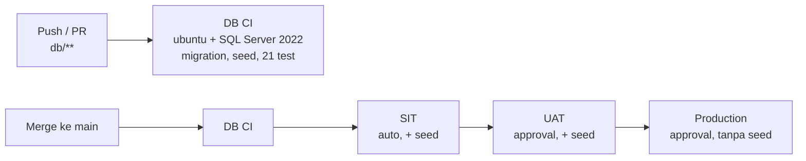

# Deployment & CI/CD – AMS (GitHub Actions)

Mengikuti SA §7: **CI (build, test) → SIT → UAT → Production**. Saat ini pipeline mencakup database;
API (IIS) dan frontend (static files) ditambahkan ke rantai yang sama di langkah 3 dan 4.

## Workflow

| File | Trigger | Isi |
| --- | --- | --- |
| `.github/workflows/db-ci.yml` | Push & PR yang mengubah `db/**` | SQL Server 2022 sementara: migration saja di DB kosong (jalur PRD), migration + seed + test, lalu ulang untuk cek idempotent |
| `.github/workflows/db-deploy.yml` | Push ke `main` (`db/migrations`, `db/seed`, `db/scripts`) atau manual | Rantai CI → SIT → UAT → Production |
| `.github/workflows/db-deploy-env.yml` | Dipanggil oleh `db-deploy.yml` | Deploy ke satu environment memakai `db/scripts/apply.ps1` di self-hosted runner |

CI berjalan di runner GitHub (cloud) dan tidak butuh akses ke jaringan kantor.
Deploy berjalan di **self-hosted runner** di intranet karena SQL Server on-prem tidak bisa diakses dari internet.

## Setup satu kali

### 1. Self-hosted runner (Windows, di intranet)

1. Siapkan VM/server Windows yang bisa menjangkau SQL Server SIT, UAT, dan PRD (misalnya APP server atau jump host).
2. GitHub repo → **Settings → Actions → Runners → New self-hosted runner** → Windows, ikuti perintah instalasi.
3. Saat konfigurasi, tambahkan label **`ams-db`** (label `self-hosted` dan `windows` otomatis).
4. Jalankan runner sebagai Windows service memakai **akun domain / gMSA** yang punya hak `db_owner` di `AMS_DB`
   (dan `dbcreator` bila database belum ada). Dengan begitu pipeline memakai Windows auth tanpa password tersimpan.
5. Pasang di runner:
   - PowerShell 7 (`pwsh`)
   - `sqlcmd` versi yang mendukung flag `-C`: **mssql-tools18** atau **go-sqlcmd** (`winget install sqlcmd`)

Bila runner hanya bisa menjangkau sebagian server, buat satu runner per environment dan beri label berbeda;
sesuaikan `runs-on` di `db-deploy-env.yml`.

### 2. GitHub Environments

Repo → **Settings → Environments**, buat tiga environment:

| Environment | Required reviewers | Deployment branches | Variables |
| --- | --- | --- | --- |
| `sit` | – | `main` | `AMS_DB_SERVER`, `AMS_DB_NAME` |
| `uat` | Admin GA / Key user | `main` | `AMS_DB_SERVER`, `AMS_DB_NAME` |
| `production` | IT Manager + DBA | `main` | `AMS_DB_SERVER`, `AMS_DB_NAME` |

Opsional bila tidak memakai Windows auth: secret `AMS_DB_USER` dan `AMS_DB_PASSWORD` per environment.
Password diteruskan lewat env `SQLCMDPASSWORD`, tidak muncul di command line maupun log.

### 3. Branch `main`

Rantai deploy dipicu oleh push ke `main`. Pekerjaan dikembangkan di branch fitur lalu di-merge ke `main` lewat pull request
(CI wajib hijau; aktifkan **branch protection** dengan status check `DB CI / Migration, seed & BR tests`).

## Menjalankan deploy

- **Otomatis:** merge PR yang mengubah `db/migrations`, `db/seed`, atau `db/scripts` ke `main`.
  SIT langsung ter-deploy; UAT dan Production menunggu approval di tab **Actions**.
- **Manual:** Actions → **DB Deploy** → **Run workflow** (branch `main`).

## Aturan

- Seed hanya masuk SIT & UAT. Production hanya migration.
- Migration yang sudah ter-deploy tidak boleh diubah; tambahkan file `V###` baru (script lama di-skip otomatis lewat `TB_S_SCHEMA_VERSION`).
- Setiap migration berjalan dalam satu transaksi; bila gagal, database tetap di versi sebelumnya dan job merah.
- Sebelum deploy Production: pastikan backup terbaru tersedia (SA §6, backup harian terenkripsi).
- Rollback: restore backup, atau buat migration `V###` korektif. Tidak ada "down migration" otomatis.
