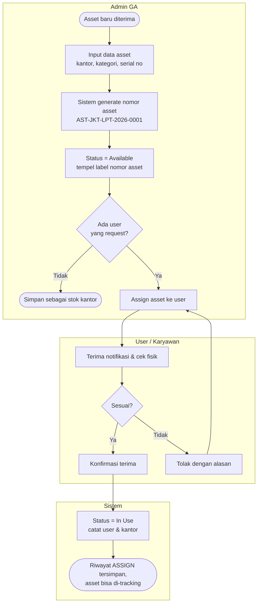
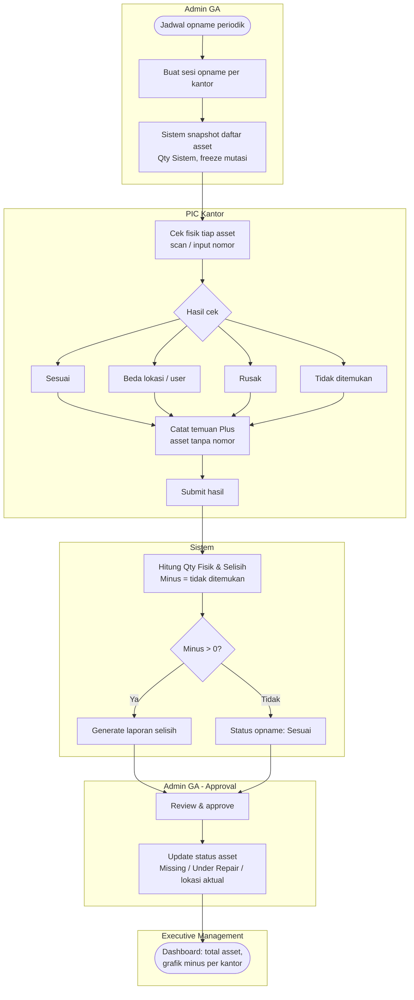

# FSD – Asset Management System Perkantoran

Oct 28, 2026 · @Ivan

## 1. Pendahuluan

Asset Management System (AMS) mencatat setiap asset kantor dengan nomor unik, siapa pemakainya, dan di kantor mana asset berada, lalu mencocokkan data sistem dengan kondisi fisik lewat stock opname berkala.

**Latar belakang.** Pencatatan asset saat ini tersebar di spreadsheet per kantor. Akibatnya posisi asset sulit dilacak, total asset tidak bisa dilihat cepat oleh manajemen, dan asset hilang baru ketahuan saat audit tahunan.

**Objective**

1. User dapat melacak setiap asset: nomor asset, user pemakai, dan kantor lokasi.
2. Executive Management dapat melihat total asset per kantor, kategori, dan status secara real-time.
3. PIC Kantor dapat melakukan pemeriksaan kondisi aktual (stock opname) dan membandingkannya dengan data di sistem.
4. Selisih minus (asset di sistem tetapi tidak ditemukan fisik) otomatis masuk laporan dan grafik dashboard.

**Scope (in)**: registrasi asset, assignment ke user, mutasi antar user/kantor, stock opname, laporan selisih, dashboard.

**Scope (out)**: depresiasi dan nilai buku akuntansi, procurement/PR-PO, maintenance scheduling, integrasi ERP. Bisa jadi fase 2.

**Use case yang dicakup**

| ID | Use Case | Aktor utama |
| --- | --- | --- |
| UC-01 | Registrasi & Assignment Asset (termasuk mutasi) | Admin GA |
| UC-02 | Stock Opname & Laporan Selisih | PIC Kantor, Admin GA, Executive |

## 2. User Role & Hak Akses

Empat role dengan prinsip least privilege: hanya Admin GA yang mengubah master asset, Executive hanya membaca.

| Role | Deskripsi | Asset Register | Assignment / Mutasi | Stock Opname | Approve Selisih | Dashboard |
| --- | --- | --- | --- | --- | --- | --- |
| Admin GA | Pengelola asset pusat | Create, Edit, View | Create | Buat jadwal, View | Ya | View |
| PIC Kantor | Penanggung jawab asset di 1 kantor | View (kantornya) | Request | Input hasil cek | Tidak | View (kantornya) |
| User / Karyawan | Pemakai asset | View (asset miliknya) | Konfirmasi terima | Tidak | Tidak | Tidak |
| Executive Management | Direksi / Dept Head | View semua | Tidak | View hasil | Tidak | View semua |

## 3. Business Process Flow

### UC-01 Registrasi & Assignment Asset

Asset baru selalu lahir berstatus Available dengan nomor unik, lalu berpindah ke In Use setelah user mengonfirmasi terima.

Mutasi (pindah user atau kantor) memakai alur yang sama mulai dari langkah Assign, dengan riwayat TRANSFER.

### UC-02 Stock Opname & Laporan Selisih

Selisih minus terbentuk dari asset yang ada di sistem tetapi tidak ditemukan fisik; setelah approve, asset tersebut menjadi Missing dan tampil di dashboard.

## 4. Functional Requirement

| ID | Modul | Requirement | Role | UC |
| --- | --- | --- | --- | --- |
| FR-01 | Asset Register | Sistem generate nomor asset otomatis format `AST-[KANTOR]-[KATEGORI]-[TAHUN]-[SEQ4]`, contoh AST-JKT-LPT-2026-0001 | Admin GA | UC-01 |
| FR-02 | Asset Register | Input data asset: nama, kategori, merk/model, serial number, tanggal perolehan, kantor, kondisi | Admin GA | UC-01 |
| FR-03 | Assignment | Assign asset ke user; status berubah Available → In Use; user mendapat notifikasi konfirmasi | Admin GA, User | UC-01 |
| FR-04 | Mutasi | Pindah asset antar user atau antar kantor dengan alasan; riwayat tersimpan | Admin GA | UC-01 |
| FR-05 | Tracking | Cari asset berdasarkan nomor asset, user, kantor, kategori, status; tampilkan riwayat pemakai | Semua (sesuai scope) | UC-01 |
| FR-06 | Stock Opname | Admin GA membuat sesi opname per kantor; sistem snapshot daftar asset sistem saat sesi dibuat | Admin GA | UC-02 |
| FR-07 | Stock Opname | PIC Kantor cek fisik per asset (scan / input nomor asset) dengan hasil: Sesuai, Beda Lokasi/User, Rusak, Tidak Ditemukan | PIC Kantor | UC-02 |
| FR-08 | Stock Opname | Asset fisik yang tidak terdaftar dicatat sebagai temuan Plus (asset tanpa nomor) | PIC Kantor | UC-02 |
| FR-09 | Rekonsiliasi | Sistem hitung selisih = Qty Sistem − Qty Fisik ditemukan per kantor & kategori | Sistem | UC-02 |
| FR-10 | Rekonsiliasi | Admin GA approve hasil; asset Tidak Ditemukan berubah status Missing | Admin GA | UC-02 |
| FR-11 | Dashboard | Kartu total asset, asset In Use, Available, Missing; grafik per kantor & kategori | Executive, Admin GA | UC-02 |
| FR-12 | Dashboard | Grafik selisih minus per kantor dan tren per periode opname; highlight merah bila minus > 0 | Executive, Admin GA | UC-02 |
| FR-13 | Laporan | Export laporan selisih (Excel/PDF) berisi daftar asset minus + user terakhir | Admin GA, Executive | UC-02 |

## 5. Data Model

Tujuh tabel inti; `TB_M_ASSET` adalah pusat, setiap perubahan pemakai/lokasi dicatat di `TB_T_ASSET_HISTORY`.

| Tabel | Kolom utama | Keterangan |
| --- | --- | --- |
| TB\_M\_OFFICE | OFFICE\_CD (PK), OFFICE\_NM, CITY, PIC\_USER\_ID | Master kantor (JKT, SBY, BDG) |
| TB\_M\_CATEGORY | CATEGORY\_CD (PK), CATEGORY\_NM | LPT Laptop, MON Monitor, PRN Printer, PRJ Proyektor, FUR Furniture |
| TB\_M\_USER | USER\_ID (PK), USER\_NM, DEPT, OFFICE\_CD (FK), ROLE\_CD | Karyawan & role akses |
| TB\_M\_ASSET | ASSET\_NO (PK), ASSET\_NM, CATEGORY\_CD (FK), BRAND\_MODEL, SERIAL\_NO, ACQ\_DT, OFFICE\_CD (FK), USER\_ID (FK, nullable), STATUS, CONDITION | Status: Available, In Use, Under Repair, Missing, Disposed |
| TB\_T\_ASSET\_HISTORY | HIST\_ID (PK), ASSET\_NO (FK), ACTION, FROM\_USER, TO\_USER, FROM\_OFFICE, TO\_OFFICE, REASON, CREATED\_BY, CREATED\_DT | ACTION: REGISTER, ASSIGN, TRANSFER, RETURN, STATUS\_CHANGE |
| TB\_T\_OPNAME\_H | OPNAME\_ID (PK), OFFICE\_CD (FK), PERIOD, STATUS, QTY\_SYSTEM, QTY\_FOUND, QTY\_MINUS, QTY\_PLUS, APPROVED\_BY | STATUS: Open, Submitted, Approved |
| TB\_T\_OPNAME\_D | OPNAME\_ID (FK), ASSET\_NO, SYS\_USER\_ID, SYS\_OFFICE, RESULT, ACTUAL\_USER\_ID, REMARK, CHECKED\_DT | RESULT: SESUAI, BEDA\_LOKASI, RUSAK, TIDAK\_DITEMUKAN, PLUS |

## 6. Spesifikasi Layar & Business Rules

| Screen ID | Nama Layar | Komponen utama | Role |
| --- | --- | --- | --- |
| SCR-01 | Dashboard | 4 KPI card (Total, In Use, Available, Missing), bar chart asset per kantor, donut per kategori, bar chart selisih minus per kantor, tabel opname terakhir | Executive, Admin GA |
| SCR-02 | Asset Register | Search & filter (kantor, kategori, status, user), tabel asset, tombol Tambah Asset | Admin GA, PIC (view) |
| SCR-03 | Form Asset | Field FR-02, nomor asset auto-generate setelah kantor & kategori dipilih | Admin GA |
| SCR-04 | Detail & Tracking | Info asset, pemakai & kantor saat ini, timeline riwayat, tombol Assign / Mutasi | Admin GA, User (asset miliknya) |
| SCR-05 | Stock Opname | Pilih kantor → buat sesi; daftar asset sistem dengan dropdown hasil cek per baris; input temuan Plus; ringkasan Qty Sistem vs Fisik vs Selisih | Admin GA, PIC Kantor |
| SCR-06 | Laporan Selisih | Daftar asset minus per sesi, user terakhir, tombol Approve & Export | Admin GA, Executive |

**Business rules**

| ID | Rule |
| --- | --- |
| BR-01 | Nomor asset unik dan tidak bisa diubah setelah disimpan; sequence reset per kantor-kategori-tahun |
| BR-02 | Satu asset hanya boleh dipegang satu user pada satu waktu; asset status Missing/Disposed tidak bisa di-assign |
| BR-03 | Mutasi antar kantor otomatis mengubah OFFICE\_CD dan memindahkan tanggung jawab ke PIC kantor tujuan |
| BR-04 | Selama sesi opname Open, asset di kantor tsb tidak bisa dimutasi (freeze) |
| BR-05 | Selisih Minus = jumlah RESULT TIDAK\_DITEMUKAN; Selisih Plus = jumlah RESULT PLUS; Qty Fisik = Qty Sistem − Minus |
| BR-06 | Sesi hanya bisa di-Submit bila semua asset sudah punya hasil cek |
| BR-07 | Saat Approve, asset TIDAK\_DITEMUKAN → status Missing; BEDA\_LOKASI → data user/kantor di-update sesuai aktual; RUSAK → Under Repair |
| BR-08 | Dashboard menandai kantor dengan Minus > 0 berwarna merah dan menampilkan jumlahnya |

## 7. Acceptance Criteria (UAT)

| TC ID | Skenario | Langkah | Expected Result | Ref |
| --- | --- | --- | --- | --- |
| TC-01 | Registrasi asset baru | Admin GA isi form, pilih kantor JKT & kategori Laptop, simpan | Nomor AST-JKT-LPT-2026-xxxx terbentuk, status Available | FR-01, BR-01 |
| TC-02 | Assign asset ke user | Pilih asset Available, assign ke user A | Status In Use, user A tercatat, riwayat ASSIGN tersimpan | FR-03 |
| TC-03 | Assign asset yang Missing | Pilih asset Missing, klik Assign | Sistem menolak dengan pesan error | BR-02 |
| TC-04 | Tracking asset | Cari nomor asset atau nama user | Tampil user & kantor saat ini + riwayat | FR-05 |
| TC-05 | Mutasi antar kantor | Mutasi asset JKT ke SBY | OFFICE\_CD = SBY, riwayat TRANSFER tersimpan | FR-04, BR-03 |
| TC-06 | Opname dengan asset hilang | Buat sesi JKT, tandai 2 asset Tidak Ditemukan, submit & approve | Selisih Minus = 2, kedua asset status Missing | FR-09, FR-10, BR-07 |
| TC-07 | Submit opname belum lengkap | Ada asset tanpa hasil cek, klik Submit | Sistem menolak, menampilkan jumlah asset belum dicek | BR-06 |
| TC-08 | Dashboard minus | Login Executive setelah TC-06 | Grafik selisih menampilkan JKT = 2 berwarna merah; total Missing bertambah 2 | FR-11, FR-12, BR-08 |
| TC-09 | Batas akses | Login User, buka asset milik orang lain | Akses ditolak | Role matrix |
