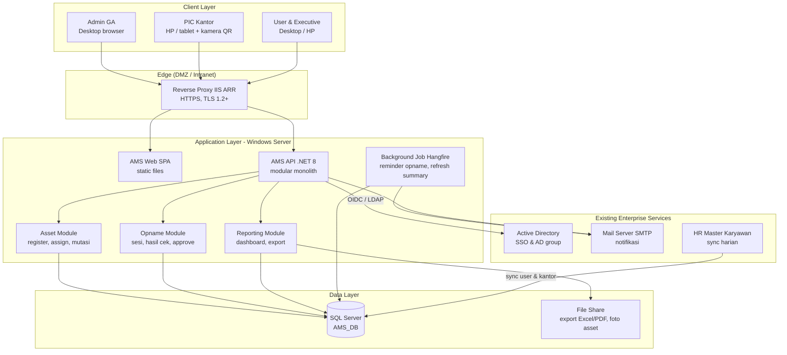
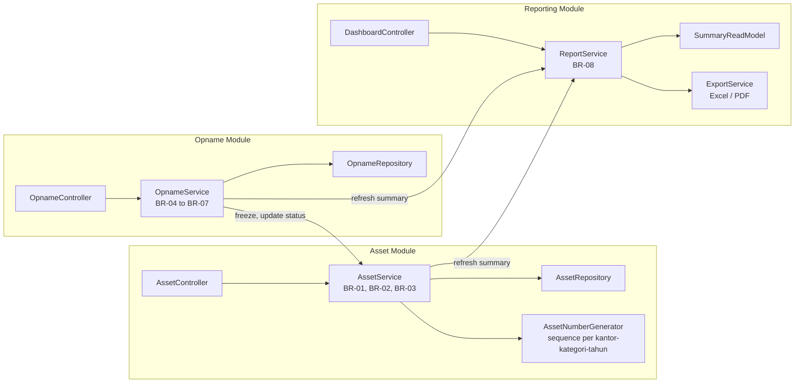
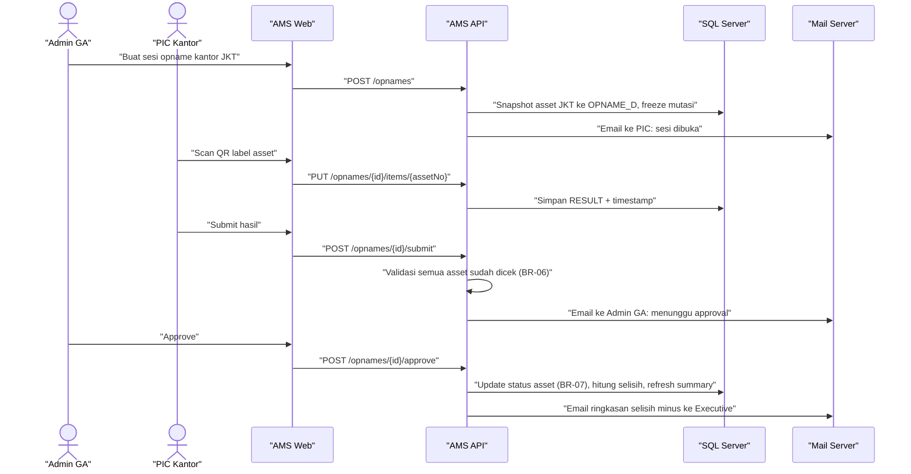
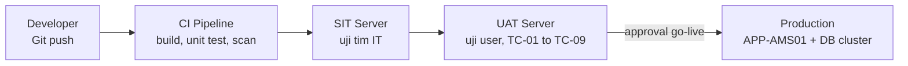

# Solution Architecture – Asset Management System

Oct 28, 2026 · @Ivan

## 1. Ringkasan

AMS dibangun sebagai web application 3-layer on-premise: SPA responsif di depan, REST API .NET 8 di tengah, SQL Server sebagai single source of truth. Pilihan ini mengikuti ekosistem existing (.NET + SQL Server on-prem) agar tim dan infrastruktur yang sudah ada bisa langsung dipakai. Referensi fungsional: FSD – Asset Management System Perkantoran (UC-01, UC-02).

**Key Architectural Decisions**:

1. **Modular monolith, bukan microservices**: 3 modul (Asset, Opname, Reporting) dalam satu API. Skala ±3 kantor dan ratusan–ribuan asset tidak membenarkan kompleksitas microservices; batas modul tetap jelas agar bisa dipisah nanti.
2. **Mobile-first web, bukan native app**: PIC Kantor melakukan stock opname dari HP/tablet dengan scan QR via kamera browser; tidak perlu distribusi app store.
3. **QR code label untuk nomor asset**: label berisi ASSET\_NO, scan langsung membuka form hasil cek dan mengurangi salah ketik saat opname.
4. **Snapshot saat sesi opname dibuat**: Qty Sistem dikunci di TB\_T\_OPNAME\_D sehingga selisih tidak berubah meski master asset berubah selama opname (didukung freeze mutasi BR-04).
5. **Dashboard dari read model teragregasi**: angka KPI & grafik dibaca dari view/summary table yang di-refresh saat transaksi dan approve, bukan query berat ke tabel transaksi setiap kali dashboard dibuka.
6. **SSO Active Directory**: login memakai akun Windows kantor; role AMS dipetakan dari AD group, tidak ada password terpisah.

| Aspek | Keputusan | Trade-off |
| --- | --- | --- |
| Deployment | On-premise, IIS / Windows Server | Tanpa biaya cloud, tapi akses luar kantor perlu VPN |
| Arsitektur | Modular monolith | Deploy sederhana; scaling per modul belum perlu |
| Frontend | SPA mobile-first | Satu codebase untuk desktop & HP |
| Data | SQL Server relasional | Konsisten dengan skill tim & tooling existing |

## 2. System Architecture

Semua request masuk lewat reverse proxy ke satu API; API adalah satu-satunya komponen yang menyentuh database, file storage, dan email.



| Layer | Komponen | Tanggung jawab |
| --- | --- | --- |
| Client | AMS Web SPA | UI responsif, scan QR via kamera (getUserMedia), render grafik dashboard |
| Edge | Reverse proxy | Terminasi HTTPS, routing `/` ke SPA dan `/api` ke API, rate limit |
| Application | AMS API | Business rules BR-01–BR-08, otorisasi role, audit trail |
| Application | Background job | Reminder jadwal opname, refresh summary dashboard, sync master karyawan |
| Data | SQL Server | Master, transaksi, history, summary dashboard |
| Data | File share | Hasil export laporan & foto asset (opsional) |

## 3. Technology Stack

| Layer | Teknologi | Alasan | Alternatif dipertimbangkan |
| --- | --- | --- | --- |
| Frontend | React + TypeScript, Vite, Tailwind CSS | Komponen reusable, mobile-first utility CSS, banyak developer tersedia | Blazor WebAssembly (satu bahasa C#, tapi bundle besar di HP) |
| Grafik | Chart.js / Recharts | Ringan, cukup untuk bar, line, donut | ECharts (lebih kaya, lebih berat) |
| Scan QR | html5-qrcode | Scan via kamera browser tanpa app native | Native app (biaya distribusi) |
| Backend | ASP.NET Core 8 Web API, C# | Selaras dengan sistem existing berbasis .NET, LTS | Node.js (skill tim lebih sedikit) |
| Data access | Entity Framework Core + Dapper untuk query report | EF untuk CRUD, Dapper untuk agregasi dashboard yang cepat | Stored procedure penuh |
| Database | SQL Server 2019/2022 | Standar enterprise existing, backup & DBA sudah ada | PostgreSQL |
| Job scheduler | Hangfire (storage di SQL Server) | Dashboard job bawaan, tanpa infrastruktur tambahan | Windows Task Scheduler |
| Auth | ASP.NET Core Identity + OIDC/LDAP ke Active Directory | SSO akun kantor, role dari AD group | Akun lokal (beban reset password) |
| Export | ClosedXML (Excel), QuestPDF (PDF) | Library .NET open source, server-side | Crystal Reports |
| Hosting | IIS on Windows Server | Infrastruktur & monitoring existing | Docker / Kubernetes (belum ada platform) |
| Logging | Serilog → SQL Server / file, health check endpoint | Audit & troubleshooting | ELK stack |
| CI/CD | Git + Azure DevOps / GitHub Actions → deploy ke IIS | Build, test, deploy otomatis per environment | Deploy manual |

## 4. Component Specifications

Setiap modul punya controller, service (business rules), dan repository sendiri; modul lain hanya memanggil lewat interface service, tidak langsung ke tabel modul lain.



**API endpoint utama** (prefix `/api/v1`, JSON, semua butuh token)

| Method | Endpoint | Fungsi | Role | Ref FSD |
| --- | --- | --- | --- | --- |
| GET | /assets?office=&cat=&status=&q= | List & filter asset (paging) | Semua, sesuai scope | FR-05 |
| POST | /assets | Registrasi asset, generate nomor | Admin GA | FR-01, FR-02 |
| GET | /assets/{assetNo} | Detail + riwayat | Semua, sesuai scope | FR-05 |
| POST | /assets/{assetNo}/assignments | Assign / mutasi / return | Admin GA | FR-03, FR-04 |
| GET | /assets/{assetNo}/qr | Label QR (PNG) untuk dicetak | Admin GA | – |
| POST | /opnames | Buat sesi + snapshot | Admin GA | FR-06 |
| PUT | /opnames/{id}/items/{assetNo} | Simpan hasil cek satu asset (scan) | PIC Kantor | FR-07 |
| POST | /opnames/{id}/plus | Catat temuan plus | PIC Kantor | FR-08 |
| POST | /opnames/{id}/submit | Submit, validasi BR-06 | PIC Kantor | – |
| POST | /opnames/{id}/approve | Approve, update status asset | Admin GA | FR-10 |
| GET | /dashboard/summary?office= | KPI + data grafik | Executive, Admin GA, PIC | FR-11, FR-12 |
| GET | /reports/variance?period=&format=xlsx | Export laporan selisih | Admin GA, Executive | FR-13 |

**Contoh response** `GET /dashboard/summary`

```json
{
  "asOf": "2026-10-28T08:00:00+07:00",
  "kpi": { "total": 33, "inUse": 25, "available": 5, "underRepair": 1, "missing": 2 },
  "lastOpname": {
    "period": "2026-09",
    "offices": [
      { "office": "JKT", "qtySystem": 17, "qtyFound": 16, "minus": 1, "plus": 0 }
    ]
  }
}
```

## 5. Integration Strategy

Tiga integrasi ke sistem existing, semuanya satu arah masuk atau notifikasi keluar; AMS tidak menulis ke sistem lain.

| Integrasi | Arah | Metode | Frekuensi | Kegagalan ditangani |
| --- | --- | --- | --- | --- |
| Active Directory | AMS → AD | OIDC / LDAP bind | Setiap login | Login ditolak, pesan jelas; tidak ada fallback akun lokal |
| HR Master Karyawan | HR → AMS | View / staging table SQL, job Hangfire | Harian 02:00 | Retry 3x, log error; data kemarin tetap dipakai |
| Mail Server | AMS → SMTP | SMTP relay internal | Event-driven (assign, sesi opname, approve) | Antri di tabel outbox, retry otomatis |

Karyawan resign dari sync HR otomatis ditandai; asset yang masih dipegangnya muncul di daftar "asset perlu ditarik" untuk Admin GA.

**Data flow UC-02 Stock Opname**



## 6. Security Architecture

Otorisasi dicek di API, bukan di UI: menyembunyikan tombol hanya kenyamanan, setiap endpoint memvalidasi role dan scope data.

| Area | Kontrol |
| --- | --- |
| Authentication | SSO Active Directory (OIDC/LDAP); token JWT umur 60 menit + refresh; logout menghapus token |
| Authorization | RBAC dari AD group: `AMS_ADMIN_GA`, `AMS_PIC_<KANTOR>`, `AMS_EXEC`, default User. Policy per endpoint |
| Data scope | Filter row-level di service: PIC hanya kantornya, User hanya asset dengan USER\_ID = dirinya |
| Transport | HTTPS wajib (TLS 1.2+), HSTS; hanya dapat diakses dari intranet / VPN |
| Input | Validasi server-side (FluentValidation), parameterized query (EF/Dapper), encoding output untuk XSS |
| Audit trail | Setiap create/update asset & opname tercatat di TB\_T\_ASSET\_HISTORY + log user, waktu, IP |
| Data at rest | Backup SQL Server terenkripsi harian, retensi 30 hari; TDE bila tersedia di lisensi |
| Segregation of duty | Pembuat sesi & approver opname = Admin GA, penginput hasil = PIC; approver tidak bisa mengubah hasil cek setelah submit |
| Web hardening | CSP, X-Frame-Options, rate limit di reverse proxy, CORS hanya domain AMS |

## 7. Scalability, Performance & Deployment

Satu app server cukup untuk fase awal; jalur scaling sudah disiapkan tanpa mengubah arsitektur.

| Kebutuhan non-fungsional | Target |
| --- | --- |
| Response API (list & detail) | < 500 ms di p95 |
| Dashboard load | < 2 detik |
| Simpan hasil scan opname | < 300 ms per asset agar scan beruntun lancar |
| Concurrent user | 50 user aktif bersamaan |
| Availability | 99% jam kerja (Senin–Jumat 07:00–19:00) |
| Volume data | Hingga 10.000 asset dan 5 tahun riwayat tanpa perubahan desain |

**Strategi scaling**:

1. **Index**: ASSET\_NO (PK), komposit (OFFICE\_CD, STATUS), (USER\_ID), (OPNAME\_ID, RESULT).
2. **Summary table**: KPI dan data grafik dihitung saat transaksi/approve, dashboard hanya membaca hasil agregat.
3. **Paging server-side**: list asset maksimal 50 baris per request.
4. **Horizontal**: API stateless (JWT), bisa ditambah node IIS di belakang load balancer bila kantor bertambah.
5. **Offline opname (fase 2)**: hasil scan disimpan sementara di perangkat lalu disinkron saat sinyal kembali, untuk gudang dengan koneksi lemah.

**Deployment**



| Environment | App server | Database | Tujuan |
| --- | --- | --- | --- |
| SIT | 1 VM, 2 vCPU / 4 GB | SQL Server shared non-prod | Integration test |
| UAT | 1 VM, 2 vCPU / 4 GB | SQL Server shared non-prod | User acceptance test |
| Production | 1 VM, 4 vCPU / 8 GB (siap jadi 2 node) | SQL Server production, backup harian | Operasional |
